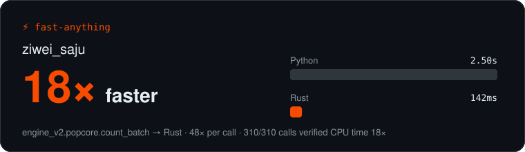

# ⚡ ziwei_saju: 1.4× faster

`python -m engine_v2.population --target 己卯 7 1 子 --sample 10` went from **2.11s** to **1.55s** (median of 5 rounds, each running the original twice and Rust once in rotated order; middle half of the rounds 1.3–1.4×).

- CPU time 1.4×: **2.10s** → **1.53s** (user + system, the app and the processes it waits for)
- A/A control, the original against itself in the same rounds: +0.4% (middle half -3.4% to +6.6%); the Rust ports' change is clearly beyond that

| function | per call | checked against |
|---|---|---|
| `engine_v2.chart.place_stars` | **1.9×** (25.8µs → 13.3µs) | 600/600 recorded real calls |
| `engine_v2.common.sanfang` | **1.3×** (322ns → 241ns) | 501/501 recorded real calls |

The original code stays in place: set `FAST_ANYTHING_DISABLE=1` to run it, or `fast-anything disable <id>` to remove the switch.

Made with [fast-anything](https://github.com/EL4CTEO/fast-anything)
